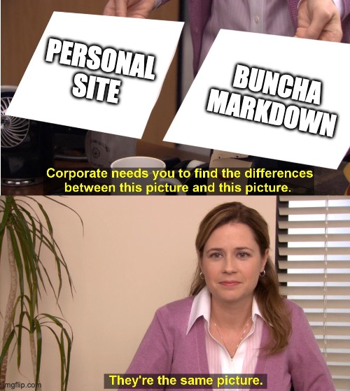

I’ve lost count of how many times I’ve redesigned this site. I think this is version 4? I think that’s how many I versions I’ve released. There’s easily 2 or 3 that I made that I just ended up scrapping. So let’s call this v4: The Atmosphere update.

We’re going to go over a few things in this post:

- Why redesign?
- What’s under the hood?
- The Atmosphere?

## Why redesign?

I started this redesign like 3+ years ago. I know, it doesn’t look like 3+ years worth of work and you would be right if a little pretentious, but if you must know I had a kid within that time and it’s had me a *little* distracted. But I started the redesign because I hated the previous tech stack. It was built on NextJS and CSS Modules. Straight up, I don’t like writing in React, NextJS in opinionated in a way that doesn’t jive with my brain, and I don’t enjoy CSS Modules.

I love to write HTML and CSS. That’s what I want to feel like I’m writing with some extra sugar for when I need to jump into something more complicated. I opted to go with Vue because it works how my brain expects and it *feels* like writing plain HTML, but plussed up. I’m also just using regular, degular CSS with some PostCSS processing. It’s so much nicer to work in. We all have to work in whack-ass environments and life is too short to maintain that energy for my personal site.

## What’s under the hood?

As for how I’m putting all this together. I’m using VitePress which is technically, primarily for documentation, but it’s fundamentally just a way to generate static pages based on Markdown and what’s a personal site if not a bunch of static pages generated from Markdown? Corporate needs you to find the differences between this picture and this picture.

And the whole shebang is deployed on Vercel. No particular reason other than I already have a bunch of other stuff there and I didn’t feel like migrating elsewhere.

But the real coolness is that this bad boy is on *The Atmosphere*.

## The Atmosphere?

Yes, the Atmosphere. [It’s the name for all the applications and websites built on the AT Protocol](https://atproto.com). A detailed explanation of the Atmosphere and AT Protocol is well beyond the scope of this blog post, but there are plenty of other [great posts on the topic](https://overreacted.io/a-social-filesystem/).

I’m very, VERY excited by the possibilities of AT Protocol and it’s largely the reason I decided to revisit this 3+ year old project. Luckily, this was surprisingly simple. I was able to quickly roll my own implementation of [Standard.Site](https://standard.site) and now all my posts are floating in the Atmosphere ready to be part of the new social web.

I could have used something like [Sequoia](https://sequoia.pub) to make this trivial, but throwing Claude at it was just as trivial and I got to see how to go about working with AT Protocol and Standard.Site in a manner that I have more control over.

## The Wrap Up

So this is my site. I plan to iterate on it a bunch over time. I’ve got a number of ideas for features, content, and design. Right now, it’s more a demo of pulling in all kinds of content I’ve generated across my various Atmosphere apps and a couple other things. It’s pretty cool, but maybe not the most sensible design for longterm growth.

I hope you dig what I’ve got going on here and I hope you build your own website and I hope you put it in the Atmosphere.
