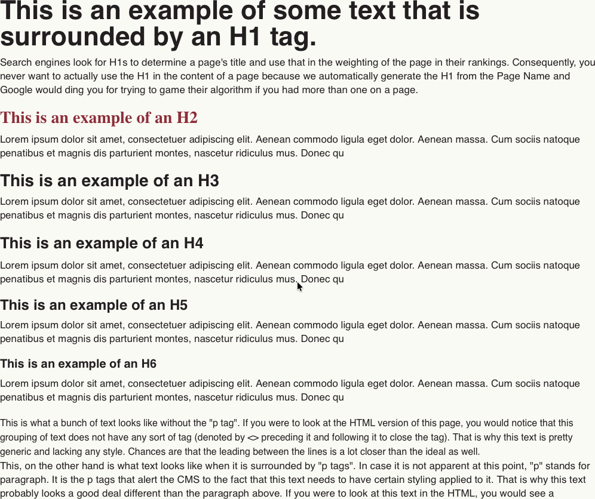
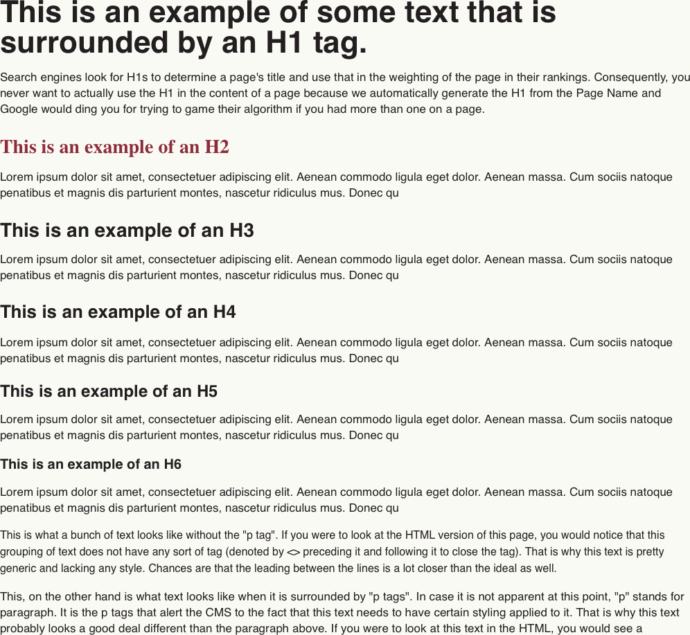

The other day I came across a bit of CSS that blew my mind. Seriously, after I learned about this I couldn’t stop talking my wife’s ear off about it for DAYS!

It’s a one-liner I got from Kevin Powell in his [*Three CSS patterns I use in every project*](https://youtube.com/watch?v=CU8Plk-53RU). Specifically, it’s the `.prose` pattern which you can check out right here:

```css
.prose > * + * {
  margin-block-start: var(--prose-flow, 1.5em);
}
```

This is my favorite kind of tip because once I saw it was so obvious; I almost felt silly for not coming up with it on my own. Because I’ve been doing what this does in 1 line in a shit ton of lines. I never even thought to re-evaluate the way I had been doing it.

So what is this even doing? This sets the spacing between elements for long form content, or “prose” (get it?), like a blog post. In fact, I’m using it for the blog posts of this site.

And what was I doing before this? I was managing the `margin-bottom` and occasionally the `margin-top` as well for every element individually. That’s each heading, `p`, `ul`, `ol`, `img`, `blockquote`, etc.

```css
h1 {
	margin-top: 0.5rem;
	margin-bottom: 0.75rem;
}

h2 {
	margin-top: 0.25rem;
	margin-bottom: 0.75rem;
}

h3 {
	margin-top: 0.125rem;
	margin-bottom: 0.75rem;
}

h4 {
	margin-bottom: 0.625rem;
}

h5 {
	margin-bottom: 0.5rem;
}

h6 {
	margin-bottom: 0.5rem;
}

p {
	margin-bottom: 1rem;
}
```

Look at all that code and that’s not even covering everything I would need to for total coverage. And want to know the kicker? All that work and it’s a worse result than this `.prose` one-liner.

Check out this example:

**Before**



**After**



The version with `.prose` is so much more balanced visually making it so much more readable. It breathes!

So why does this work? What makes this so clever? Well, beyond being one line, it makes use of `em`s. If you don’t know what `em`s are they are a unit relative to the `font-size` of the element. This means that elements with larger text, like headings, get proportionally larger space above them which is exactly what you want in this scenario. It’s classic print media typography in action.

And the `* + *` in the selector means that I only want this to apply to elements that follow a preceding element. The `+` is the sibling selector that selects whatever matches the selector on the right of the `+` so long as there is a preceding sibling that matches the selector on the left of the `+`. You need this part because it eliminates any issues of leading or trailing margins. If you didn’t do this and just selected all elements with no sibling consideration you would need another rule like `.prose > *:first-child { margin-block-start: 0; }` to remove the leading margin. And then it’s not a one-liner. It’s a two-liner, which is still pretty good, but it’s not slick. One-liners a slick.

The final benefit is that we’re using CSS Custom Properties along with fallback values to actually set the margin. This gives us a handy custom prop, `--prose-flow` that we can use to adjust the spacing as needed to make a things more condensed or open.

I love this bit of CSS. Seriously, I just wrote 500+ words on it because I can’t stop appreciating it. Hopefully, you’ll adopt this in your own projects.